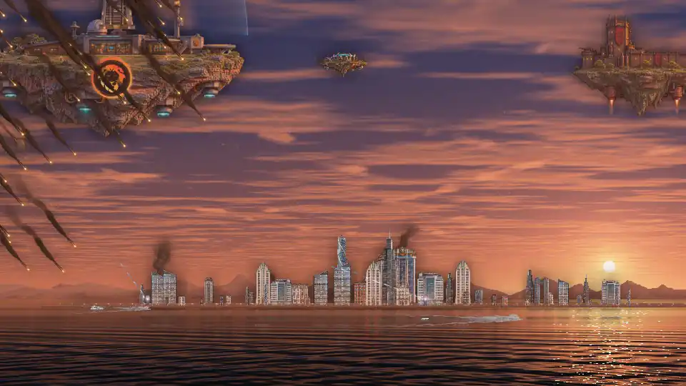
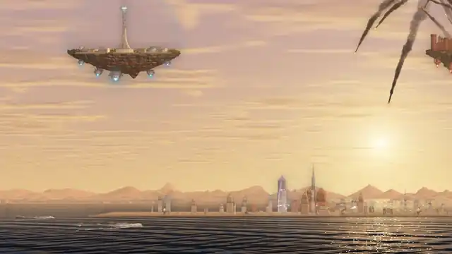
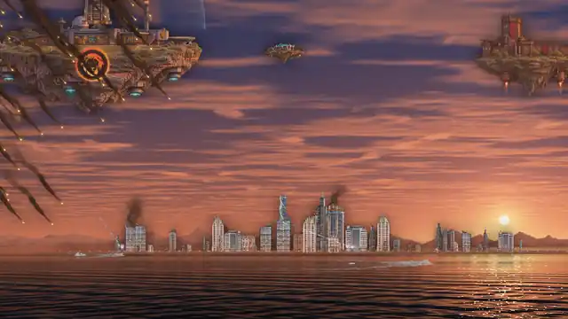
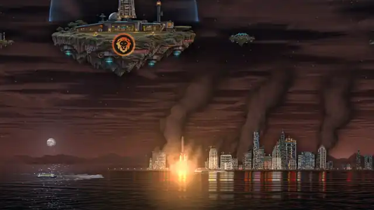
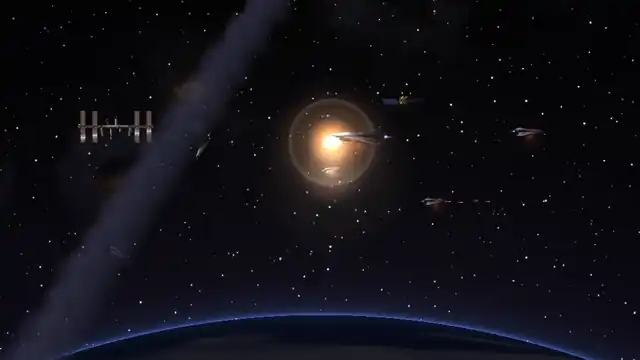
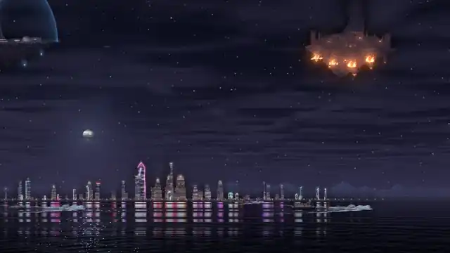
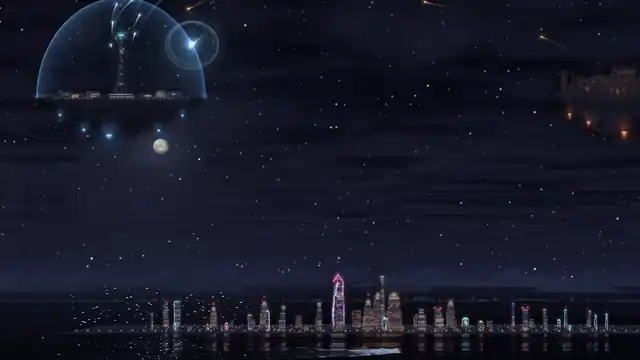
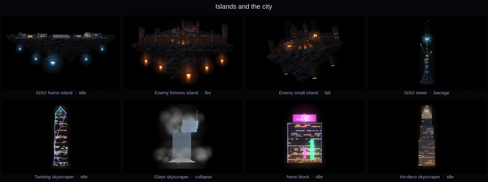

<h1 align="center">SISO Background</h1>

<b>A living sky war, painted and played live in the browser.</b> 
Floating islands, a city under siege, rockets to orbit and alien palaces: one endless scene that tells its own story,
and hands you the camera whenever you want it.

  <a href="https://background.sisolabs.space/scene"><b>Play the scene</b></a> ·
  <a href="https://background.sisolabs.space">Every asset, broken down</a> ·
  <a href="#run-it">Run it</a> ·
  MIT

No video: every frame is drawn live by Canvas 2D and a WebGL2 sky, from a seeded world. About 80 assets are written
in code, and 108 paintings (most graded for day, dusk and night, 209 images) draw over them in black and ember, with
the SISO lion crest on the home island. Time is the only state, so any second of the scene looks the same on every
machine.

## The story

Left alone, the scene plays a 5½-minute loop: 15 beats, one after another. The camera flies itself and the hour
turns from golden hour to night. The bar along the bottom shows where you are, and you can jump to any beat.

<table>
<tr>
<td width="50%"> <b>3. Raid.</b> The enemy island fires two ripples of missiles into the city.</td>
<td width="50%"> <b>5. Hellfire.</b> A sheet of a hundred missiles rolls across the city.</td>
</tr>
<tr>
<td> <b>6. Launch.</b> A rocket lifts off from the quay, and the camera rides it all the way up.</td>
<td> <b>7. Strike.</b> In orbit, its warheads take an enemy wing apart.</td>
</tr>
<tr>
<td> <b>10. Island fall.</b> SISO jets knock out the island's engines, and it comes down on the city.</td>
<td> <b>15. Tower hellfire.</b> The tower hits the new island with everything it has. Then it all starts again.</td>
</tr>
</table>

All 15 beats

| # | Beat | What happens |
|---|---|---|
| 1 | Across the cities | The neon district, the desert town, then the SISO home bay |
| 2 | The tower | A quiet minute at the SISO tower; a police boat runs down a smuggler |
| 3 | Raid | The enemy island fires two ripples of missiles into the city |
| 4 | Rebuild | Cranes come up out of the rubble and the blocks go back up |
| 5 | Hellfire | A sheet of a hundred missiles rolls across the city |
| 6 | Launch | A rocket lifts off from the quay; the camera rides it up |
| 7 | Strike | In orbit, its warheads take an enemy wing apart |
| 8 | Back down | The enemy opens up on the tower; the shield takes it |
| 9 | Tower barrage | The tower answers with a swarm from its ports |
| 10 | Island fall | SISO jets knock out the island's engines; it comes down on the city |
| 11 | On the floor | Smoke over the flattened blocks |
| 12 | Respawn | The city builds itself back; a new island is lowered in |
| 13 | Jets | A SISO wing sweeps the bay |
| 14 | Across to the tower | Back along the city to the tower |
| 15 | Tower hellfire | The tower hits the new island with everything; then round again |

The script is [`src/story/script.js`](src/story/script.js): when each event fires, where the camera goes and what
it follows. `?story=0` turns the story off and gives you the open world instead, with random events along an endless
coast.

## Take the camera

| Key | Does |
|---|---|
| <kbd>Shift</kbd>+<kbd>A</kbd> / <kbd>Shift</kbd>+<kbd>D</kbd> (or the arrows) | Fly left and right; hold to go faster |
| <kbd>Shift</kbd>+<kbd>W</kbd> / <kbd>Shift</kbd>+<kbd>S</kbd> | Climb above the clouds and on to space, then come back down |
| <kbd>[</kbd> / <kbd>]</kbd> | Previous or next beat of the story |
| Drag, swipe | The same on a phone |

Let go, and 15 seconds later the camera eases back onto the story.

## Every asset, broken down

[background.sisolabs.space](https://background.sisolabs.space) shows every piece on black, by family: skies,
mountains, islands, cities, boats, aircraft, defences, effects, space and aliens. Click one to flip through them
all, in every state and at day or night.

## As a desktop background

The story is also cut into six chapters, published beside the scene at
[background.sisolabs.space/chapters/](https://background.sisolabs.space/chapters/index.json): each an animated WebP
of about a minute that plays once and holds its last frame, with an `index.json` that lists them in order with their
sha256. We play one as our [T3 Code](https://github.com/pingdotgg/t3code) background every 20 minutes, between other
scenes; anything that can show an image can play them.

## How it's built

- `index.html` is the scene, `breakdown.html` is every asset as stills on black (`node tools/stills.mjs` paints
  them; they aren't committed), and `assets.html` is the older live gallery.
- `CONTRACT.md` says how every piece is made; read it before you add one. `ASSETS.md` lists every asset, its states
  and its file.
- `src/core/`: light, paint and seeded randomness, shared by every asset.
- `src/assets/<family>/`: one file per asset. `src/assets/registry.js` lists them all.
- `src/engine/`: the camera, the world, the director that schedules the random events, and the WebGL sky and sea.
- `src/events/`: one file per event (patrols, flybys, the wars). `src/events/README.md` says how to add one.
- `src/story/`: the story loop: the script and the director that plays it.
- `art/map.json`: which painted image draws which asset, in which state and light. `tools/art.py` builds them into
  `img/` from the art releases, and `src/core/sprites.js` draws them. `img/` isn't in git: without it, or with
  `?art=0`, every asset draws its coded art.
- `refs/`: the reference paintings the assets are matched to. The rest of `art/` is the earlier photo art, kept as
  references.
- `media/`: the pictures in this README, filmed from the scene with `tools/film.mjs` and cut with `tools/cut.py`.
- `rounds/<name>/`: each build round's reasoning and before/after shots.

## Run it

`python3 tools/serve.py 8765`, then open http://127.0.0.1:8765/.

Query options:

| Option | Does |
|---|---|
| `?beat=10` | Start at a beat |
| `?story=0` | The open world |
| `?h=21` | Start at 9 pm (the open world) |
| `?zoom=1` | Show the whole width (1.25 by default) |
| `?stats=1` | Show frame times |
| `?art=0` | Only the coded art, no painted images |
| `?grade=blue` | The earlier blue night instead of black and ember |
| `&freeze=1&t=30` | Hold one moment |
| `&events=hellfire` | Play only that event |
| `&y=-6900` | Start in space |

Check it. Each check prints PASS or FAIL last, and they need Chromium and ImageMagick:

- `node tools/story-check.mjs`: the story's events plan and land on screen, and every beat draws.
- `node tools/check.mjs`: every asset.
- `node tools/engine-check.mjs`, `node tools/events-check.mjs` and `node tools/gallery-check.mjs`.
- `node tools/perf.mjs`: frame times; FAIL on a stall.
- `node tools/clean-check.mjs`: fails if any file names a path on someone's own machine, because this folder is
  published as it is.

Film it: `node tools/film.mjs FILM/a --from 0 --to 330 --fps 8 --size 960x540` writes the frames of any stretch of
the story (split the loop into parts and run them side by side; a rerun picks up where it stopped). Then
`python3 tools/cut.py FILM` cuts them into this README's media and the desktop chapters.

Publish the site: `tools/site.sh` builds it into `site/` (the breakdown at `/`, the scene at `/scene`), then
`npx wrangler deploy` from this folder puts it on background.sisolabs.space.

Made by [SISO](https://www.sisolabs.space). Code: MIT. The photo art under `art/isles/marina` and `art/isles/fx` is
MIT, from an earlier SISO project.
